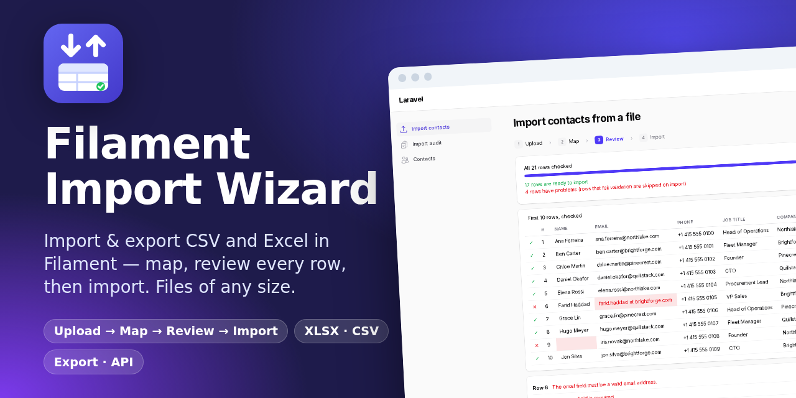
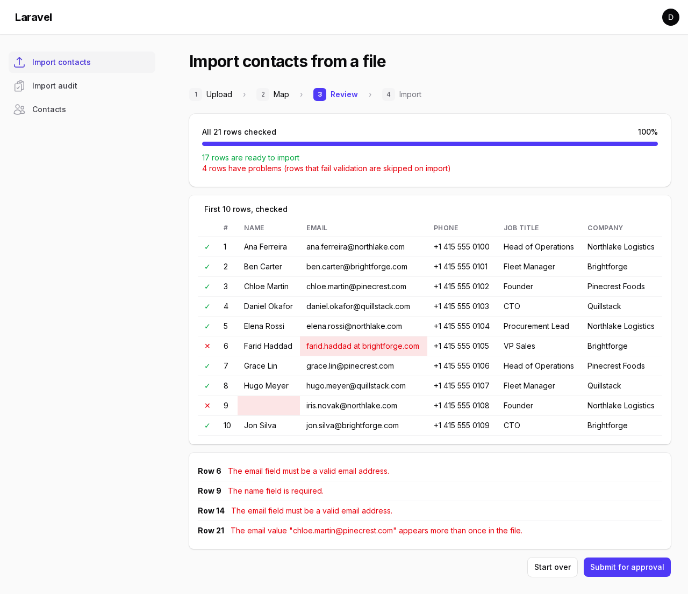
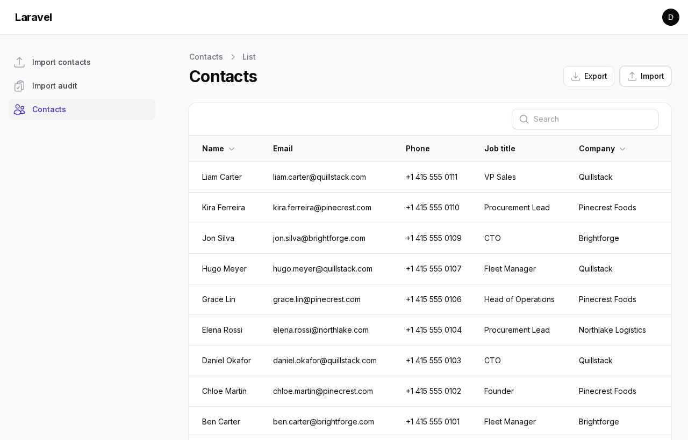
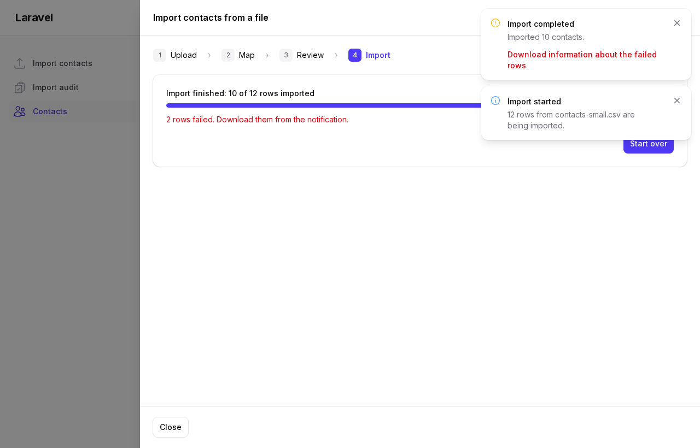

<p align="center"></p>
<h1 align="center">Filament Import Wizard</h1>
<p align="center"><strong>Import and export CSV and Excel in Filament: map the columns, check every row, then import.</strong></p>
<p align="center">
  
  
  
  
  <a href="https://github.com/solutionforest/filament-import-wizard/actions/workflows/ci.yml"></a>
  
  
</p>

Your users have a spreadsheet; your Filament app needs the rows. This package gives you a four-step **Upload → Map → Review → Import** wizard for [Filament](https://filamentphp.com) v5 that accepts **CSV and Excel** files, shows **every row checked before anything is written**, and imports files of any size. It also **exports** a list back to Excel / CSV in the layout the importer reads, so files round-trip, and the same engine is available as a plain **API class** when you need no screen. It sits on top of Filament's own `Importer` classes, so **your existing importers work unchanged**.

```text
Upload a file → map the columns → review every row → import (queued) → export it back whenever you like
```

**You provide:** a Filament `Importer` (columns and rules), and where to put the button or page. **The package provides:** the wizard, the live preview, the validation (with a verified fast path), chunked uploads, export and templates, an optional audit trail and approval flow, and a headless API.



## What you get

| Feature | What it does |
| --- | --- |
| **Four-step import wizard** | Upload → Map → Review → Import, as a page or in a [slide-over](docs/slide-over.md) opened from a button on any list page, with optional start / done **Filament notifications** |
| **CSV, XLSX, XLS, ODS** | Multi-sheet workbooks, odd encodings (UTF-16, Windows-1252) and delimiters handled; typed cells (dates, booleans, formula results) read right — [file formats](docs/file-formats.md) |
| **Works with your spreadsheet library** | Files from **maatwebsite/excel, spatie/simple-excel, rap2hpoutre/fast-excel**, the box/spout engine of nikazooz/laravel-simplesheet and xlswriter-format files import cleanly, and our exports read back in them — tested with the real libraries — [interop](docs/interop.md) |
| **Smart column mapping** | Matched by name, label, aliases and fuzzy similarity; sample values under each field; required columns enforced |
| **Live preview tables** | See how the first rows will be imported while you map, and the first rows with ✓ / ✕ and highlighted problem cells in Review |
| **Check before you import** | Every row validated with your importer's own rules, with exact messages, error counts per column and the first failing rows — [how it works](docs/how-it-works.md) |
| **One rules class for forms *and* imports** | Define a record's rules once (`FieldRules`) and use them in the Filament form, the importer and an API — [rules](docs/rules.md) |
| **File-level checks** | e.g. duplicates inside the file, in constant memory (`UniqueInFile`) — [rules](docs/rules.md) |
| **Fast** | A verified fast path validates **50,000 rows in under a second** (fuzz-, exhaustive- and mutation-tested against Laravel) — [performance](docs/performance.md) |
| **Huge files** | Streamed, never loaded into memory; **resumable chunked upload** with no PHP size limit; a console command for multi-GB files — [large files](docs/large-files.md) |
| **Export that round-trips (互通)** | Excel / CSV download of any list (filters and sorting applied) in the importer's own layout, a blank **import template**, and `verify()` to prove the file would import cleanly — [export](docs/export.md) |
| **Headless API** | `HeadlessImport` runs the same upload → map → review → import pipeline from an API endpoint, a job or a command — [headless API](docs/headless-api.md) |
| **Audit trail** *(optional)* | Who imported what (file SHA-256, mapping, review result, outcome) with an immutable event history and an **Import audit** page — [audit](docs/audit-and-approval.md) |
| **Approval flow** *(optional)* | Maker–checker: hold an import for a second person, by rule (e.g. over 1,000 rows) — [audit & approval](docs/audit-and-approval.md) |
| **Multi-panel, multi-server** | Per-panel disk, directory and limits; shared-disk / database-backed state so any server can take any request; Horizon and Octane notes — [scaling](docs/scaling.md) |
| **Translated** | English, 简体中文, 繁體中文 (TW / HK); plural-aware, locale-aware numbers and dates, RTL-safe — [localization](docs/localization.md) |
| **Secure by default** | Locked wizard state, escaped output, confined uploads, allow-listed importer options, CSV formula guard on export; dedicated security tests and `composer audit` in CI |
| **Quality gates** | PHPStan level 10, 113 Pest tests, security group, differential fuzz, mutation test, 50k–200k-row stress tests, CI matrix (PHP 8.2–8.4 × Laravel 12/13) — [testing](docs/testing.md) |

## Video tutorial

[](docs/video/tutorial.mp4)

▶ **[Watch the tutorial (mp4, 115 s)](docs/video/tutorial.mp4)** — the **slide-over** import from a list page with Filament notifications; then upload an Excel file, map columns with a live preview, review every row, submit for approval,
approve and read the audit trail; then a **50,000-row file** (chunked upload, reviewed in about two seconds) and the interface in **Hong Kong Traditional Chinese**.
Chapters and how it was recorded: [docs/video-tutorial.md](docs/video-tutorial.md).

## Supported versions

| Package | PHP | Laravel | Filament | Livewire | Status |
| --- | --- | --- | --- | --- | --- |
| **0.10.x** | 8.2 – 8.4 ¹ | **12** ✅ · **13** ✅ · 11.28+ ² | **5.x** (tested on 5.11) | 4.x (via Filament 5) | **Current** |
| 0.2 – 0.9 | 8.2 – 8.4 ¹ | 12 · 13 | 5.x | 4.x | Superseded — upgrade to 0.10 |
| — | — | — | 3.x · 4.x | — | Not supported (built on Filament 5's importer and schema APIs) |

✅ = the full test suite (Pest, 113 tests + fuzz, mutation and stress suites) passes on it · ¹ run on PHP 8.4; 8.2 and 8.3 are allowed by the constraints but were not run ·
² allowed by Filament 5, not run — every Laravel 11.x release is currently flagged by Composer security advisories, so upgrade to 12+.

| Environment | Status |
| --- | --- |
| Queue | `sync` (tested), `database` / `redis` / `sqs` via Filament batches · **Horizon**: supported — see [Scaling](docs/scaling.md) |
| **Octane** | Code-reviewed for state leaks; not run under a live Octane server — see [Scaling](docs/scaling.md) |
| Database | SQLite (tested). MySQL / PostgreSQL use only standard Laravel query-builder calls but were not run here |
| File storage | `local` (tested). Any Flysystem disk (S3, NFS…) is supported by design; S3 was not run here |
| Browsers | Chromium (tested) |

Release notes: [CHANGELOG.md](CHANGELOG.md).

## Install

```bash
composer config repositories.filament-import-wizard vcs https://github.com/solutionforest/filament-import-wizard.git
composer require solution-forest/filament-import-wizard:^0.10
php artisan migrate
```

You also need Filament's import tables and a queue worker — see [Installation](docs/installation.md).

## Quick start

**1. Make a page for an importer you already have**

```php
use SolutionForest\FilamentImportWizard\Pages\ImportWizardPage;

class ImportContacts extends ImportWizardPage
{
    protected static ?string $importer = ContactImporter::class;
}
```

**2. Register it on a panel**

```php
use SolutionForest\FilamentImportWizard\ImportWizardPlugin;

$panel->plugin(ImportWizardPlugin::make()->pages([ImportContacts::class]));
```

**3. Open the page** — upload, map, review, import. That's it.

Prefer a button on a list page? The same wizard opens in a **slide-over** with Filament notifications:

```php
protected function getHeaderActions(): array
{
    return [ImportWizardAction::make()->importer(ContactImporter::class)];
}
```

And the matching **export** button, plus the same pipeline as an **API** with no screen:

```php
ExportFileAction::make()->importer(ContactImporter::class)      // Excel / CSV / blank template, re-importable

$review = HeadlessImport::for(ContactImporter::class)->upload($request->file('file'))->autoMap()->review();
$review->isValid() && $import->user($user)->start();            // queued, like the wizard
```

| Button on the list page | Map, in the slide-over | Review, in the slide-over | Done, with notifications |
| --- | --- | --- | --- |
|  |  |  |  |

## Documentation

| | |
| --- | --- |
| [Installation](docs/installation.md) | Composer, migrations, queue |
| [Usage](docs/usage.md) | The page, the plugin, several panels |
| [How it works](docs/how-it-works.md) | The four steps, mapping, preview |
| [Export](docs/export.md) | Excel / CSV export and templates that round-trip with the importer |
| [Headless API](docs/headless-api.md) | Import from an API / job / command, no screen |
| [Slide-over action](docs/slide-over.md) | Open the wizard from a button, with start / done notifications |
| [Rules](docs/rules.md) | One rules class for forms and imports; file-level checks |
| [File formats](docs/file-formats.md) | CSV, Excel, encodings, sheets |
| [Other spreadsheet libraries](docs/interop.md) | maatwebsite/excel, spatie/simple-excel, fast-excel, simplesheet, xlswriter |
| [Large files](docs/large-files.md) | Chunked upload, console import |
| [Audit & approval](docs/audit-and-approval.md) | Optional trail and maker–checker |
| [Scaling](docs/scaling.md) | Several servers, Horizon, Octane |
| [Configuration](docs/configuration.md) | Every option in one place |
| [Localization](docs/localization.md) | Languages, overriding texts, adding a locale |
| [Performance](docs/performance.md) | Stress test results (50k–200k rows) and how to run them |
| [Testing](docs/testing.md) | How the fast validation path is verified (fuzz, exhaustive, mutation) |
| [Video tutorial](docs/video-tutorial.md) | Chapters and how it was recorded |

## Try the demo

```bash
git clone https://github.com/solutionforest/filament-import-wizard.git && cd filament-import-wizard
composer install && composer serve      # http://127.0.0.1:8765/admin
```

Upload `workbench/samples/contacts.xlsx`. The [demo README](workbench/README.md) explains what to click and where each piece lives.

## Development

```bash
composer check     # Pint + PHPStan level 10 + Pest + security tests + composer audit
composer stress    # 50,000-row stress test (flat memory, exact counts)
composer security  # security tests (XSS, traversal, tampering, authorisation, uploads) + dependency audit
composer fuzz      # 300,000-case differential fuzz of the fast validation path vs Laravel
composer mutate    # mutation test of the fast path
```

MIT — see [LICENSE](LICENSE).
