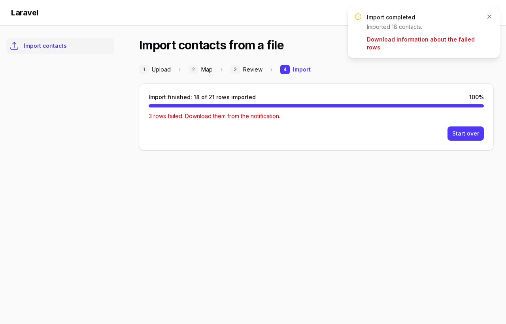

# Filament Import Wizard

> **Internal package — self-hosted distribution only.** It lives in Solution Forest's private repository and is
> installed through Composer's VCS repository mechanism. It is not published to Packagist.

A step-by-step **Upload → Map → Review → Import** page for [Filament](https://filamentphp.com) v5 that accepts
**CSV and Excel (XLSX, XLSM, ODS, XLS)** files, checks every row *before* anything is written, and imports files of
any size through Filament's own queued importer. It is built on Filament's `Importer` / `ImportColumn` classes, so
**any importer you already have works unchanged.**

| 1 · Upload | 2 · Map |
| --- | --- |
|  |  |
| **3 · Review** | **4 · Import** |
|  |  |

## Features

- **CSV, XLSX, XLSM, ODS and XLS** – spreadsheets are streamed into a UTF-8 CSV (OpenSpout, constant memory); legacy `.xls` uses PhpSpreadsheet when installed. Multi-sheet workbooks ask which sheet to import. CSV in UTF-16 / Windows-1252 is transcoded automatically; the delimiter is auto-detected.
- **Huge files** – never loaded into memory. The file is addressed by byte offset, validated in polled slices and imported by one queued job per slice (`ImportCsvSlice`, a thin subclass of Filament's `ImportCsv`) whose payload is just an offset and a row count. For files too big for a browser upload there is a console command (below).
- **Cross-check before the import starts** – Review dry-runs the importer's own *remap → cast → validate* pipeline over **every** row (nothing is saved) plus optional file-level checks such as duplicates, with live progress and the failing rows. Import unlocks when the check has finished.
- **Reusable rules** – rules live in their own classes and rule sets instead of being re-typed in every importer (see below).
- **Smart column mapping** – matched by name, label, `guess()` aliases, normalised names (`E-mail` ↔ `email`), trailing words (`Full name` ↔ `name`) and fuzzy similarity; a file column is used once; sample values are shown; required mappings are enforced.
- **Multi-panel** – register it per panel with its own disk, directory and limits; uploads are kept per panel.
- **Filament-native** – `FileUpload`, `ImportColumn::getSelect()`, schema components, `ImportDispatcher` (events, `imports` / `failed_import_rows` tables, failed-rows CSV, completion notification) and Filament's CSS variables, so it follows your panel theme and dark mode.
- **Safe by default** – the upload path and all wizard state are Livewire `#[Locked]`; paths must live inside the panel's upload directory; mappings are checked against the real importer columns and file headers.
- **Strict code** – PHPStan level 10 (Larastan) and a Pest suite.

## Installation (self-hosted)

Add the private repository to the consuming project, then require the package:

```bash
composer config repositories.filament-import-wizard vcs git@github.com:solutionforest/filament-import-wizard.git
composer require solution-forest/filament-import-wizard:^0.2
```

(`composer.json` of the app ends up with a `repositories` entry of `"type": "vcs"`; CI needs a deploy key / token with read access to the repository.)

Then the usual Filament import tables and a queue worker:

```bash
php artisan make:queue-batches-table   # job_batches, if you do not have it yet
php artisan vendor:publish --tag=filament-actions-migrations
php artisan migrate
```

Optional: `composer require phpoffice/phpspreadsheet` to accept legacy `.xls` files.

## Usage

Create a normal Filament importer (`php artisan make:filament-importer Contact`), then add a page for it:

```php
use SolutionForest\FilamentImportWizard\Pages\ImportWizardPage;

class ImportContacts extends ImportWizardPage
{
    protected static ?string $importer = ContactImporter::class;
}
```

Register it on a panel with the plugin (recommended — gives per-panel settings):

```php
use SolutionForest\FilamentImportWizard\ImportWizardPlugin;

$panel->plugin(
    ImportWizardPlugin::make()
        ->pages([ImportContacts::class])
        ->disk('s3')               // where uploads are stored
        ->directory('imports')     // uploads go to imports/{panel-id}/
        ->chunkSize(1000)          // rows per queued job
        ->rowsPerReviewRequest(5000)
        ->maxCollectedErrors(100)
        ->maxUploadSize(512 * 1024), // KB
);
```

…or simply `->pages([ImportContacts::class])` for the defaults. The page title, navigation and authorization
(`canAccess()`, `shouldRegisterNavigation()`) work like any Filament page.

### Multiple panels

Register the plugin on each panel with its own settings. Settings are resolved from the panel the request is
served on; each panel stores uploads under `{directory}/{panel-id}/` and a path from another panel's directory is
rejected. A page class can be shared between panels.

### Reusable rules

Validation does not have to be retyped in each importer. Use the rule sets, or the rule classes directly:

```php
use SolutionForest\FilamentImportWizard\Rules\CommonRules;

ImportColumn::make('email')->rules(CommonRules::email()),
ImportColumn::make('phone')->rules(CommonRules::phone()),                 // optional phone
ImportColumn::make('joined')->rules(CommonRules::date(formats: ['Y-m-d', 'd/m/Y'])),
ImportColumn::make('status')->rules(CommonRules::oneOf(['active', 'archived'])),
ImportColumn::make('age')->rules(CommonRules::integer(required: false, min: 0, max: 120)),
```

`CommonRules` also has `name()` and `url()`. Each method returns a plain list, so it can be merged with extra rules.
The building blocks are ordinary Laravel `ValidationRule` classes you can use anywhere:
`Rules\PhoneNumber`, `Rules\DateInFormats`, `Rules\OneOfIgnoringCase`. Write your own the same way and put it in a
rule set of your app. Messages are translatable (`filament-import-wizard::rules`).

### File-level checks (duplicates in the file)

Some problems only show up across rows. Add `RowCheck`s to the page; they run during Review next to the rules:

```php
use SolutionForest\FilamentImportWizard\Checks\UniqueInFile;

protected function getRowChecks(): array
{
    return [new UniqueInFile(['email'])];   // or ['first_name', 'last_name'] for a combination
}
```

`UniqueInFile` keeps its seen-set in a throw-away SQLite file, so memory stays constant for multi-million-row
files. Implement `Checks\RowCheck` for your own checks. Note that file-level checks inform the Review step only:
the queued import runs slices in parallel and applies your importer's `resolveRecord()` (so a duplicate row will
update the earlier one) — fix the file if that is not what you want.

### Very large files: console import

A browser upload is bounded by PHP / Livewire limits. For multi-GB files put the file on a disk (scp, rsync, a
mounted volume) and run the same pipeline server-side:

```bash
php artisan import-wizard:run "App\Filament\Imports\ContactImporter" imports/big.csv --disk=s3 --user=1
php artisan import-wizard:run "App\Filament\Imports\ContactImporter" imports/big.xlsx --sheet=1 --map="email=Work Email" --dry-run
```

It auto-maps columns (override with `--map=column=Header`), validates every row with progress, prints the first failing
rows, refuses to import when there are problems unless `--force`, then queues the same sliced import.

### Tuning on the page

Override on your page class for page-specific behaviour: `getUploadDisk()`, `getUploadDirectory()`, `getChunkSize()`,
`getRowsPerReviewRequest()`, `getMaxCollectedErrors()`, `getMaxUploadSizeInKilobytes()`, `getRowChecks()`,
`getAcceptedFileTypes()`.

## Try the demo

The repository ships a ready-to-run demo panel (Orchestra Workbench + SQLite, no setup):

```bash
git clone git@github.com:solutionforest/filament-import-wizard.git
cd filament-import-wizard
composer install
composer serve          # http://127.0.0.1:8765/admin  (auto-signed-in demo user)
```

Open **Import contacts** and upload `workbench/samples/contacts.xlsx` (or `contacts.csv`). The sample has 4 problems
that Review catches: two malformed e-mails, one missing name and one duplicate e-mail. The demo importer
(`workbench/app/Filament/Imports`) uses `CommonRules` and the page uses `UniqueInFile`.

> The demo signs a user in automatically (`workbench/app/Http/DemoLogin.php`) — demo only, never copy that.

## Known limits

- Excel: one sheet per import. Cell values are read as displayed values; dates become `Y-m-d H:i:s`. `.xls` is loaded fully into memory by PhpSpreadsheet, so keep such files modest (use `.xlsx` for big files).
- Browser uploads are bounded by your PHP / Livewire limits (`upload_max_filesize`, `post_max_size`, `livewire.temporary_file_upload`) — use the console command beyond that.
- Review validates against the importer's rules and your `RowCheck`s; `resolveRecord()`, hooks and database writes happen in the real import.
- Filament imports do not run per-record policy checks – authorize inside your importer if you need to.

## Development

```bash
composer install
composer check          # PHPStan level 10 + Pest
```

## License

Proprietary — see `LICENSE`.
