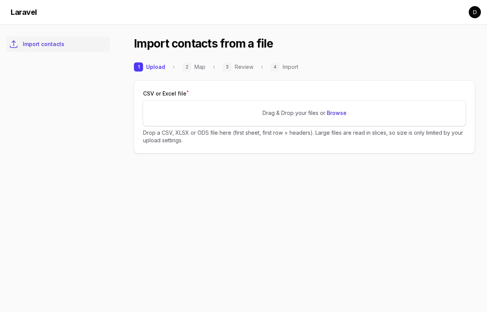
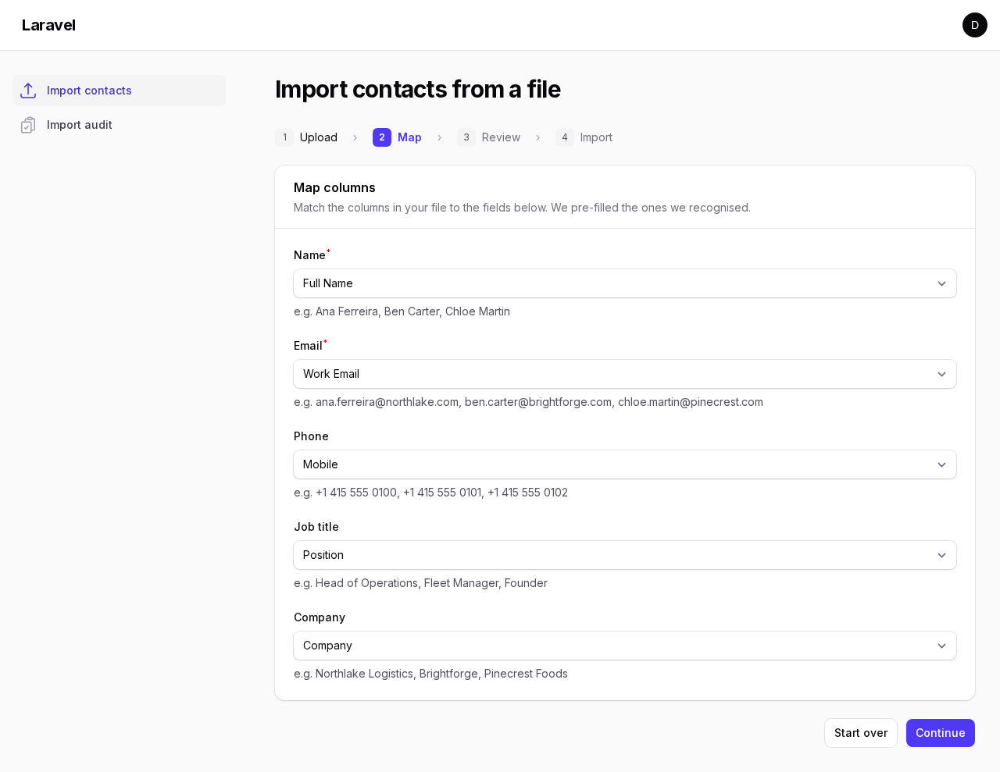
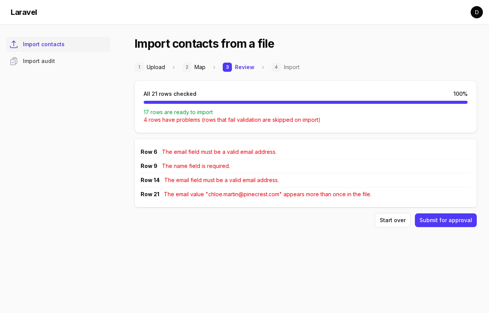
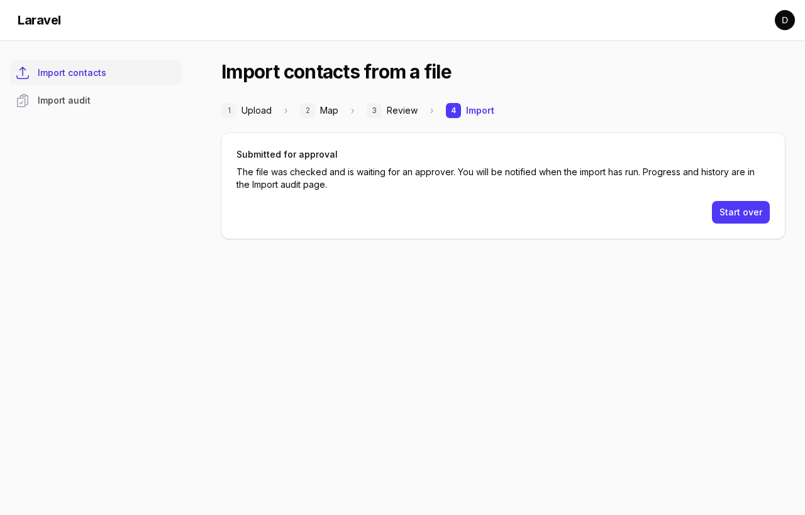
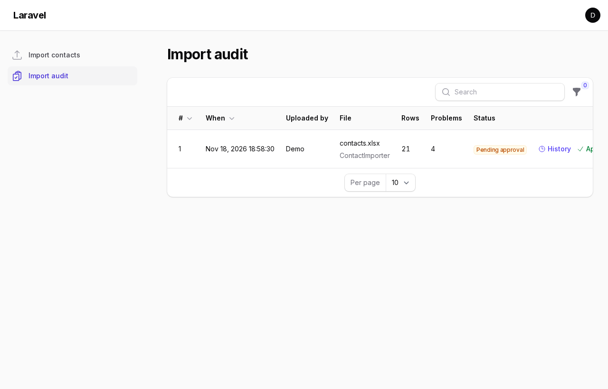
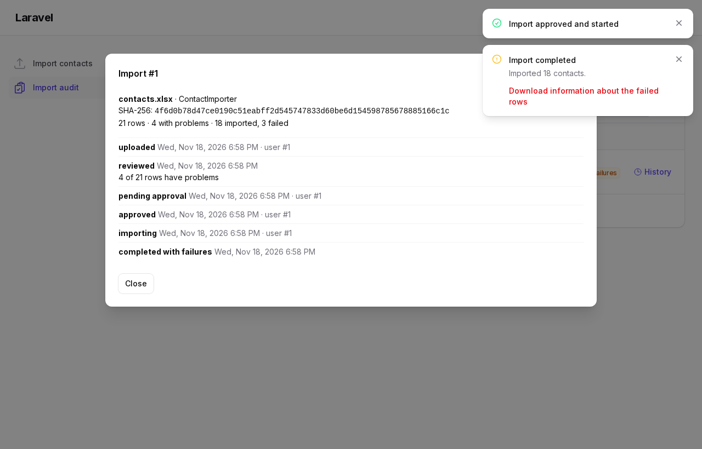

# Filament Import Wizard

> **Internal package — self-hosted distribution only.** It lives in Solution Forest's private repository and is
> installed through Composer's VCS repository mechanism. It is not published to Packagist.

A step-by-step **Upload → Map → Review → Import** page for [Filament](https://filamentphp.com) v5 that accepts
**CSV and Excel (XLSX, XLSM, ODS, XLS)** files, checks every row *before* anything is written, and imports files of
any size through Filament's own queued importer. It is built on Filament's `Importer` / `ImportColumn` classes, so
**any importer you already have works unchanged.**

| 1 · Upload | 2 · Map |
| --- | --- |
|  |  |
| **3 · Review** | **4 · Submitted for approval** |
|  |  |
| **Audit trail + approve / reject** | **History of one import** |
|  |  |

## Features

- **CSV, XLSX, XLSM, ODS and XLS** – spreadsheets are streamed into a UTF-8 CSV (OpenSpout, constant memory); legacy `.xls` uses PhpSpreadsheet when installed. Multi-sheet workbooks ask which sheet to import. CSV in UTF-16 / Windows-1252 is transcoded automatically; the delimiter is auto-detected.
- **Audit flow (optional)** – every run is recorded (who, which file + SHA-256, mapping, review result, outcome) with an immutable event trail, and imports can optionally be held for a second person's approval (maker–checker). See *Audit & approval*.
- **Huge files, no browser limit** – never loaded into memory, and uploads are sent in small resumable chunks straight to the disk, so PHP's `upload_max_filesize` / `post_max_size` no longer cap the file size. See *Chunked uploads*.
- **Huge files** – never loaded into memory. The file is addressed by byte offset, validated in polled slices and imported by one queued job per slice (`ImportCsvSlice`, a thin subclass of Filament's `ImportCsv`) whose payload is just an offset and a row count. For files too big for a browser upload there is a console command (below).
- **Cross-check before the import starts** – Review dry-runs the importer's own *remap → cast → validate* pipeline over **every** row (nothing is saved) plus optional file-level checks such as duplicates, with live progress and the failing rows. Import unlocks when the check has finished.
- **One rules class for forms *and* imports** – define a record's rules once (`FieldRules`) and apply them to Filament form fields, importer columns and plain data (API / console), so they never drift apart (see below).
- **Smart column mapping** – matched by name, label, `guess()` aliases, normalised names (`E-mail` ↔ `email`), trailing words (`Full name` ↔ `name`) and fuzzy similarity; a file column is used once; sample values are shown; required mappings are enforced.
- **Multi-panel** – register it per panel with its own disk, directory and limits; uploads are kept per panel.
- **Filament-native** – `FileUpload`, `ImportColumn::getSelect()`, schema components, `ImportDispatcher` (events, `imports` / `failed_import_rows` tables, failed-rows CSV, completion notification) and Filament's CSS variables, so it follows your panel theme and dark mode.
- **Safe by default** – the upload path and all wizard state are Livewire `#[Locked]`; paths must live inside the panel's upload directory; mappings are checked against the real importer columns and file headers.
- **Strict code** – PHPStan level 10 (Larastan) and a Pest suite.

## Installation (self-hosted)

Add the private repository to the consuming project, then require the package:

```bash
composer config repositories.filament-import-wizard vcs git@github.com:solutionforest/filament-import-wizard.git
composer require solution-forest/filament-import-wizard:^0.2
```

(`composer.json` of the app ends up with a `repositories` entry of `"type": "vcs"`; CI needs a deploy key / token with read access to the repository.)

Then the usual Filament import tables and a queue worker:

```bash
php artisan make:queue-batches-table   # job_batches, if you do not have it yet
php artisan vendor:publish --tag=filament-actions-migrations
php artisan migrate
```

Optional: `composer require phpoffice/phpspreadsheet` to accept legacy `.xls` files.

## Usage

Create a normal Filament importer (`php artisan make:filament-importer Contact`), then add a page for it:

```php
use SolutionForest\FilamentImportWizard\Pages\ImportWizardPage;

class ImportContacts extends ImportWizardPage
{
    protected static ?string $importer = ContactImporter::class;
}
```

Register it on a panel with the plugin (recommended — gives per-panel settings):

```php
use SolutionForest\FilamentImportWizard\ImportWizardPlugin;

$panel->plugin(
    ImportWizardPlugin::make()
        ->pages([ImportContacts::class])
        ->disk('s3')               // where uploads are stored
        ->directory('imports')     // uploads go to imports/{panel-id}/
        ->chunkSize(1000)          // rows per queued job
        ->rowsPerReviewRequest(5000)
        ->maxCollectedErrors(100)
        ->maxUploadSize(512 * 1024), // KB
);
```

…or simply `->pages([ImportContacts::class])` for the defaults. The page title, navigation and authorization
(`canAccess()`, `shouldRegisterNavigation()`) work like any Filament page.

### Multiple panels

Register the plugin on each panel with its own settings. Settings are resolved from the panel the request is
served on; each panel stores uploads under `{directory}/{panel-id}/` and a path from another panel's directory is
rejected. A page class can be shared between panels.

### One rules class for forms and imports

Write what a record must look like **once**, then use it in the Filament form, the importer and anywhere else:

```php
use SolutionForest\FilamentImportWizard\Rules\CommonRules;
use SolutionForest\FilamentImportWizard\Rules\FieldRules;
use SolutionForest\FilamentImportWizard\Rules\RuleContext;

class ContactRules extends FieldRules
{
    protected function define(RuleContext $context): array
    {
        return [
            'name'  => CommonRules::name(max: 80),
            'email' => [
                ...CommonRules::email(),
                // a form keeps e-mails unique (ignoring the record being edited);
                // an import updates existing contacts, so it must not reject them
                ...($context->isForm() ? [Rule::unique('contacts', 'email')->ignore($context->record)] : []),
            ],
            'phone' => CommonRules::phone(),
        ];
    }

    public function messages(): array   { return ['email.email' => 'Please give a real e-mail address.']; }
    public function attributes(): array { return ['phone' => 'phone number']; }
}
```

```php
// Filament form (resource or page) – rules, required asterisk, messages and attribute names are applied by field name
public static function form(Schema $schema): Schema
{
    return $schema->components(ContactRules::form([
        TextInput::make('name'),
        TextInput::make('email'),
        TextInput::make('phone'),
    ]));
}

// Importer – the same definition, by column name
public static function getColumns(): array
{
    return ContactRules::import([
        ImportColumn::make('name')->requiredMapping(),
        ImportColumn::make('email')->guess(['mail']),
        ImportColumn::make('phone'),
    ]);
}

// Anywhere else (API controller, console command, test)
$data = ContactRules::make()->validate($request->all(), record: $contact);
```

- `RuleContext` lets one definition adapt: `$context->isForm()` / `isImport()`, `$context->record` (the record being edited; resolved lazily in forms, so edit pages get `unique()->ignore()` for free) and `isEditing()`.
- Fields are matched by name; fields without rules are left untouched. `'required'` also marks the form field required (asterisk).
- For the importer's own messages return `ContactRules::make()->messages()` from `getValidationMessages()`.
- The building blocks are plain Laravel rules, so they work in any validator: `CommonRules::email() / phone() / name() / url() / integer() / date() / oneOf()` and the `ValidationRule` classes `Rules\PhoneNumber`, `Rules\DateInFormats`, `Rules\OneOfIgnoringCase` (translatable messages in `filament-import-wizard::rules`). Write your own `ValidationRule` and drop it into a definition.

### File-level checks (duplicates in the file)

Some problems only show up across rows. Add `RowCheck`s to the page; they run during Review next to the rules:

```php
use SolutionForest\FilamentImportWizard\Checks\UniqueInFile;

protected function getRowChecks(): array
{
    return [new UniqueInFile(['email'])];   // or ['first_name', 'last_name'] for a combination
}
```

`UniqueInFile` keeps its seen-set in a throw-away SQLite file, so memory stays constant for multi-million-row
files. Implement `Checks\RowCheck` for your own checks. Note that file-level checks inform the Review step only:
the queued import runs slices in parallel and applies your importer's `resolveRecord()` (so a duplicate row will
update the earlier one) — fix the file if that is not what you want.

### Chunked uploads (no PHP size limit)

Livewire's normal upload is bounded by `upload_max_filesize` / `post_max_size`. Turn on chunked uploads and the
browser slices the file and POSTs each slice (sized to fit your PHP limits) straight to the panel's disk:

```php
ImportWizardPlugin::make()->pages([ImportContacts::class])->chunkedUploads()->maxUploadSize(20 * 1024 * 1024) // 20 GB, in KB
```

- Resumable per chunk (3 retries), progress bar, drag & drop. A 16 MB file went through a default `php -S` (2 MB / 8 MB limits) in 10 chunks.
- All state — a manifest and one object per chunk — lives **on the disk**, not in the session or local storage, so with a shared disk any web server can take any chunk and assemble the file.
- Endpoints are authenticated panel routes (`/{panel}/import-wizard/upload/{start,chunk,complete}`); uploads belong to the user who started them; only csv/txt/xlsx/xlsm/ods/xls are accepted; the size cap is enforced when the upload starts.
- Joining the chunks needs temporary local disk space equal to the file size (`sys_get_temp_dir()`) and a request that can run long enough to copy it — raise `max_execution_time` for that request if you upload many GB.
- Clean up abandoned uploads: `php artisan import-wizard:prune-uploads` (schedule it daily, `->onOneServer()`).

### Audit & approval

Auditing is **optional and off by default**. Switch it on per panel with `->audit()` (requiring approval switches it on too) and run `php artisan migrate` (the migrations are auto-loaded). Each audited run gets an
`import_wizard_audits` row — user, panel, importer, file name, **SHA-256 of the uploaded file**, IP, mapping, options,
row counts, review summary, the resulting Filament `Import`, imported / failed counts — plus an append-only
`import_wizard_audit_events` trail (`uploaded → reviewed → [pending_approval → approved|rejected] → importing → completed[_with_failures]`).
The **Import audit** page (registered on the panel only when auditing is on) lists them with filters and a History modal.
Every transition also fires `ImportAuditStatusChanged`, so you can forward it to your activity log / SIEM / chat:

```php
Event::listen(ImportAuditStatusChanged::class, fn ($e) => Log::channel('audit')->info('import', [
    'audit' => $e->audit->id, 'from' => $e->from?->value, 'to' => $e->to->value, 'actor' => $e->actorId,
]));
```

Require a second person to approve (maker–checker) — always, or by rule:

```php
ImportWizardPlugin::make()
    ->requireApproval(fn (ImportAudit $audit) => $audit->total_rows > 1000)   // or ->requireApproval()
    ->canApproveUsing(fn (User $user, ImportAudit $audit) => $user->hasRole('import-approver'))
    ->canViewAllAuditsUsing(fn (User $user) => $user->hasRole('auditor'))      // others see their own
    ->allowSelfApproval(false);                                                // default: the uploader cannot approve
```

With approval on, the last wizard button becomes **Submit for approval**: the file is reviewed but nothing is
written. An approver opens *Import audit* and approves (the import then runs **as the original uploader**, so their
completion notification and failed-rows download stay theirs) or rejects with a reason. Without closures, approval
follows the `approve-imports` Gate ability and viewing follows `view-all-import-audits` when you define them, else any panel user.
Without `->audit()` / `->requireApproval()` nothing is recorded, no page is added and no tables are touched.

### Running on several servers

| Concern | What to do |
| --- | --- |
| Where files live | Use a **shared disk** (S3, NFS…) for `->disk()` — uploads, converted CSVs and chunks must be readable by every web server *and* every queue worker. A `local` disk only works on one machine. |
| Browser upload | Enable `->chunkedUploads()`. Chunk state is on the disk, so a load balancer may send each chunk to a different server. (Livewire's own temporary upload would need `livewire.temporary_file_upload.disk` on shared storage.) |
| Review state | Set `IMPORT_WIZARD_SEEN_STORE=database` (config `import-wizard.seen_store`) so `UniqueInFile` keeps its seen-set in the shared database; the default `sqlite` file is local to one server. Run `php artisan migrate`. |
| Queue | A real queue (`redis`, `database`, `sqs`) with workers anywhere that can reach the same disk and database; the `job_batches` table; a shared cache store (Redis) for Filament's job overlap locks. |
| Sessions | A shared session driver (database / Redis) as for any load-balanced Laravel app. |
| Audit | Lives in the database, so it is central. |
| Housekeeping | Schedule `import-wizard:prune-uploads` on one server (`->onOneServer()`). |
| Console import | `import-wizard:run` can run on any server that sees the disk. |

### Very large files: console import

A browser upload is bounded by PHP / Livewire limits. For multi-GB files put the file on a disk (scp, rsync, a
mounted volume) and run the same pipeline server-side:

```bash
php artisan import-wizard:run "App\Filament\Imports\ContactImporter" imports/big.csv --disk=s3 --user=1
php artisan import-wizard:run "App\Filament\Imports\ContactImporter" imports/big.xlsx --sheet=1 --map="email=Work Email" --dry-run
```

It auto-maps columns (override with `--map=column=Header`), validates every row with progress, prints the first failing
rows, refuses to import when there are problems unless `--force`, then queues the same sliced import.

### Tuning on the page

Override on your page class for page-specific behaviour: `getUploadDisk()`, `getUploadDirectory()`, `getChunkSize()`,
`getRowsPerReviewRequest()`, `getMaxCollectedErrors()`, `getMaxUploadSizeInKilobytes()`, `getRowChecks()`,
`getAcceptedFileTypes()`.

## Try the demo

The repository ships a ready-to-run demo panel (Orchestra Workbench + SQLite, no setup):

```bash
git clone git@github.com:solutionforest/filament-import-wizard.git
cd filament-import-wizard
composer install
composer serve          # http://127.0.0.1:8765/admin  (auto-signed-in demo user)
```

Open **Import contacts** and upload `workbench/samples/contacts.xlsx` (or `contacts.csv`). The sample has 4 problems
that Review catches: two malformed e-mails, one missing name and one duplicate e-mail. The demo uses chunked uploads and
requires approval above 20 rows (self-approval allowed, since the demo has one user), so you can click through
upload → review → *Submit for approval* → **Import audit** → Approve. The demo importer
(`workbench/app/Filament/Imports`) uses `CommonRules` and the page uses `UniqueInFile`.

> The demo signs a user in automatically (`workbench/app/Http/DemoLogin.php`) — demo only, never copy that.

## Known limits

- Excel: one sheet per import. Cell values are read as displayed values; dates become `Y-m-d H:i:s`. `.xls` is loaded fully into memory by PhpSpreadsheet, so keep such files modest (use `.xlsx` for big files).
- The standard (non-chunked) browser upload is bounded by PHP / Livewire limits — enable `->chunkedUploads()` or use the console command. Chunk assembly needs local temp space equal to the file size.
- Review validates against the importer's rules and your `RowCheck`s; `resolveRecord()`, hooks and database writes happen in the real import.
- Filament imports do not run per-record policy checks – authorize inside your importer if you need to.

## Development

```bash
composer install
composer check          # PHPStan level 10 + Pest
```

## License

Proprietary — see `LICENSE`.
