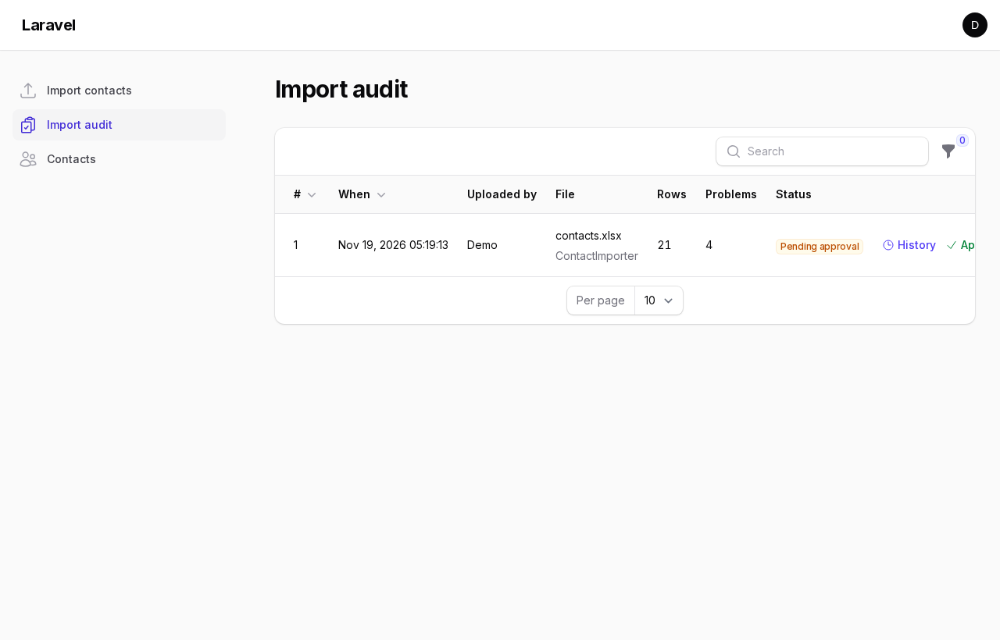
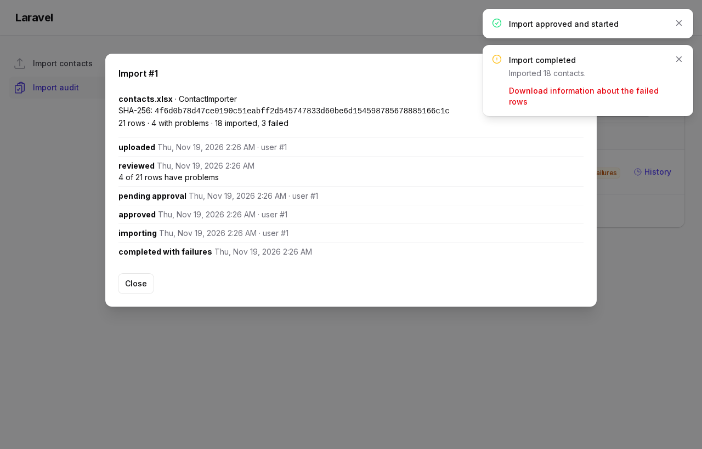

# Audit & approval

Both are **optional and off by default**. Without them there is no audit page and the last wizard button is simply **Import** — "Submit for approval" appears only when you call `requireApproval()` and the rule applies to that import.

## Audit trail

```php
ImportWizardPlugin::make()->pages([ImportContacts::class])->audit();
```

Then `php artisan migrate`. Each run gets an `import_wizard_audits` row — user, panel, importer, file name, **SHA-256 of the
uploaded file**, IP, mapping, options, row counts, review summary, the resulting Filament `Import` and imported / failed
counts — plus an append-only `import_wizard_audit_events` trail:

`uploaded → reviewed → [pending approval → approved | rejected] → importing → completed | completed with failures`

An **Import audit** page (added to the panel only when auditing is on) lists them with filters and a History view.



Every transition fires `ImportAuditStatusChanged` — forward it to your activity log, SIEM or chat:

```php
Event::listen(ImportAuditStatusChanged::class, fn ($e) => Log::channel('audit')->info('import', [
    'audit' => $e->audit->id, 'from' => $e->from?->value, 'to' => $e->to->value, 'actor' => $e->actorId,
]));
```

## Approval (maker–checker)

Hold imports for a second person — always, or by rule. Requiring approval switches the audit on.

```php
ImportWizardPlugin::make()
    ->requireApproval(fn (ImportAudit $audit) => $audit->total_rows > 1000)   // or ->requireApproval()
    ->canApproveUsing(fn (User $user, ImportAudit $audit) => $user->hasRole('import-approver'))
    ->canViewAllAuditsUsing(fn (User $user) => $user->hasRole('auditor'))     // others see their own
    ->allowSelfApproval(false);                                               // default
```

With approval on, the last wizard button becomes **Submit for approval**: the file is reviewed, nothing is written. An approver
opens *Import audit*, then approves (the import runs **as the original uploader**, so their notification and failed-rows
download stay theirs) or rejects with a reason.



- The uploader cannot approve their own import unless you opt in with `allowSelfApproval()`.
- Without closures, approval follows the `approve-imports` Gate ability and viewing follows `view-all-import-audits` when you
  define them — otherwise **any other panel user can approve**. Define one before production.
- Don't capture request-scoped objects in these closures (see [Scaling → Octane](scaling.md)).
