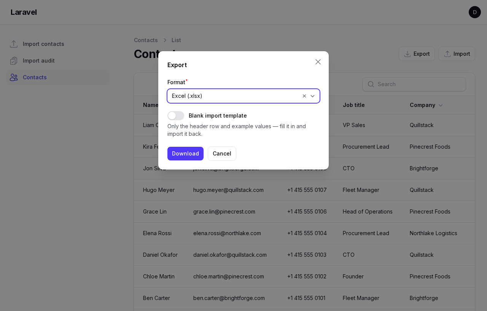

# Export — and the round trip

Export uses the **same columns as the importer**, so a file you export can be edited in Excel and imported straight back — and it is proven to pass the same rules.



## A button on a list page

```php
use SolutionForest\FilamentImportWizard\Actions\ExportFileAction;
use SolutionForest\FilamentImportWizard\Actions\ImportWizardAction;

protected function getHeaderActions(): array
{
    return [
        ExportFileAction::make()->importer(ContactImporter::class),
        ImportWizardAction::make()->importer(ContactImporter::class),
    ];
}
```

The modal asks for **Excel (.xlsx)** or **CSV** and offers a **blank import template** (header row + the importer's example values). The download contains what the table is
showing — search, filters and sorting included. `->filename('contacts')` sets the download name.

## From code (no screen)

```php
use SolutionForest\FilamentImportWizard\Export\FileExport;

FileExport::for(ContactImporter::class)
    ->query(Contact::query()->where('active', true)->orderBy('name'))   // any Eloquent query or relation
    ->format('xlsx')                                                    // or 'csv'
    ->columns(['name', 'email'])                                        // optional subset / order
    ->resolve('company', fn (Contact $c) => $c->company?->name)         // optional per-column override
    ->download('contacts.xlsx');                                        // streamed response — or ->store('exports/c.xlsx', 's3')
```

Records are read in chunks (`lazyById`, or your own `orderBy` with `lazy`) and written as they come, so memory stays flat: 50,000 rows to XLSX in about 2.4 s, with
the exported file re-reviewed as 100 % valid (see `composer stress`).

## Why it round-trips (互通)

| Aspect | What the export does | So the importer… |
| --- | --- | --- |
| **Headers** | the importer's own column names (`exampleHeader()` when set) | maps every column automatically |
| **Order of columns** | the importer's column order | — |
| **Dates** | `Y-m-d H:i:s` | reads them as dates |
| **Booleans** | `1` / `0` | casts them back |
| **Lists** (`->array(';')`, `->multiple()`) | joined with the column's own separator | splits them again |
| **Relationships** (`->relationship(resolveUsing: 'name')`) | the related record's lookup column | resolves the same record |
| **Backed enums** | their value | casts them back |
| **Empty values** | empty cell | reads `null` (as every Filament importer does) |
| **Phone numbers, codes** (`0012345`) | written as **text** cells | keep their leading zeros |
| **Excel vs CSV** | both read by the same wizard (sheets, encodings, delimiters handled) | — |

For anything that isn't just an attribute of the same name use `->resolve()`.

## Rules stay valid: `verify()`

Data that is already in your database may not satisfy the importer's rules (an old record with a bad e-mail). `verify()` runs the exported file through the importer's own
rules — the same engine as Review, nothing is imported — and tells you which rows would not survive a round trip:

```php
$review = FileExport::for(ContactImporter::class)->format('xlsx')->verify();

$review->isValid();        // false
$review->invalidRows;      // 1
$review->sample;           // [['row' => 12, 'errors' => ['email' => ['The email field must be a valid email address.']]]]
```

## Formula injection

A CSV opened in Excel can execute cells that start with `=`, `+`, `-` or `@`. CSV exports therefore prefix such values with an apostrophe (`'=HYPERLINK(…)`); plain numbers (`-5`,
`+5`) are left alone. **The importer removes that guard apostrophe when it reads a CSV**, so protected files still round-trip. XLSX cells are always written as text and
need no protection. Turn the guard off for machine-to-machine files with `->protectCsv(false)`.

## Blank templates

`->template()` (or the toggle in the modal) writes the header row plus the importer's `example()` / `examples()` values — a ready-made file for people to fill in and import. The
template itself imports cleanly (tested).
