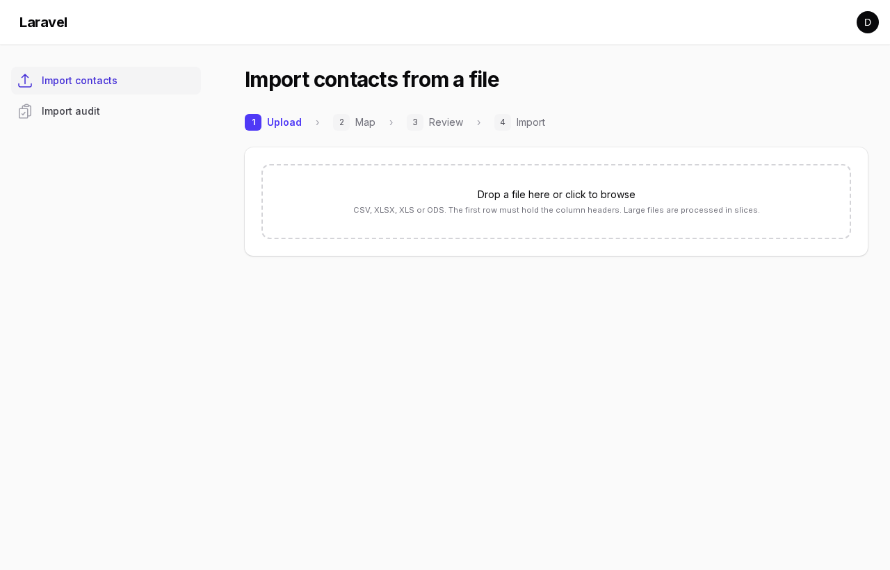
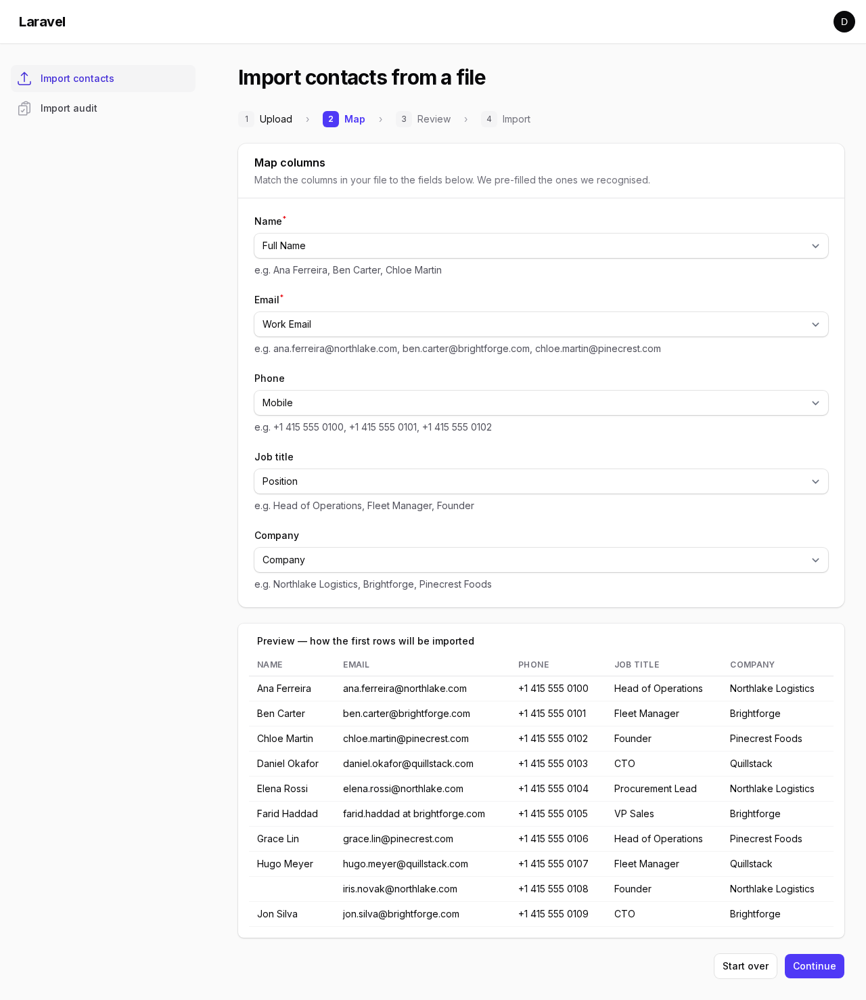
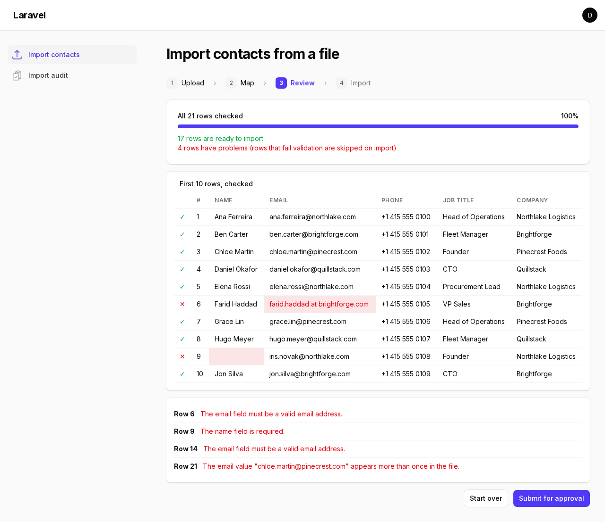
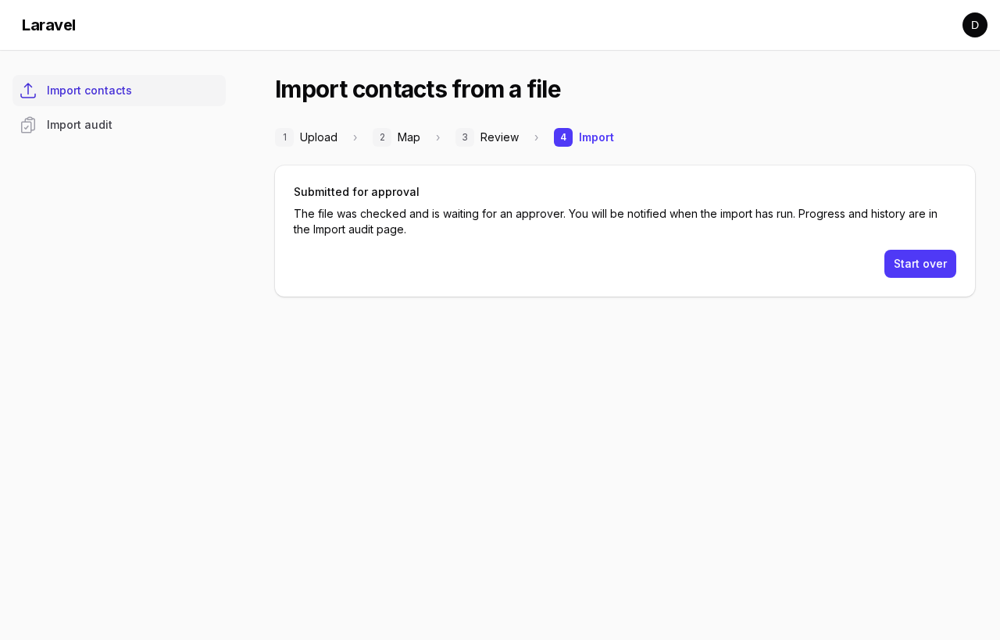

# How it works

| 1 · Upload | 2 · Map |
| --- | --- |
|  |  |
| **3 · Review** | **4 · Submitted for approval** *(optional)* |
|  |  |

## 1. Upload
Drop a CSV, XLSX, XLS or ODS file. Spreadsheets with several sheets ask which sheet to use; other encodings are
converted to UTF-8; the delimiter is detected. See [File formats](file-formats.md). For files too big for a normal
browser upload, turn on [chunked uploads](large-files.md).

## 2. Map
Each importer column gets a file column, pre-filled automatically by matching:
the column name or label, `guess()` aliases, normalised names (`E-mail` ↔ `email`), trailing words (`Full name` ↔ `name`)
and fuzzy similarity. A file column is used once. Sample values appear under each field, required columns must be mapped,
and a **preview table** shows how the first rows will be imported — it updates as you change a mapping.

## 3. Review
Every row is checked with your importer's own rules (remap → cast → validate), a few thousand rows per request, with a
progress bar. Nothing is written. You see:

- how many rows are ready and how many have problems,
- a **preview table of the first rows** with ✓/✕ per row and the offending cells highlighted,
- the first failing rows with the exact messages.

File-level checks (such as duplicates within the file) run here too — see [Rules](rules.md). The **Import** button
unlocks when the check has finished.

## 4. Import
The file is handed to Filament's queued importer, one job per slice of the file, with a live progress bar. Failed rows are
downloadable from Filament's completion notification, exactly as with the stock import action. With
[approval](audit-and-approval.md) on, this step is replaced by "submitted for approval".

## What is and isn't checked
Review validates against the importer's rules and your row checks. `resolveRecord()`, hooks and database writes happen in
the real import, and Filament imports do not run per-record policy checks — authorize inside your importer if you need to.
