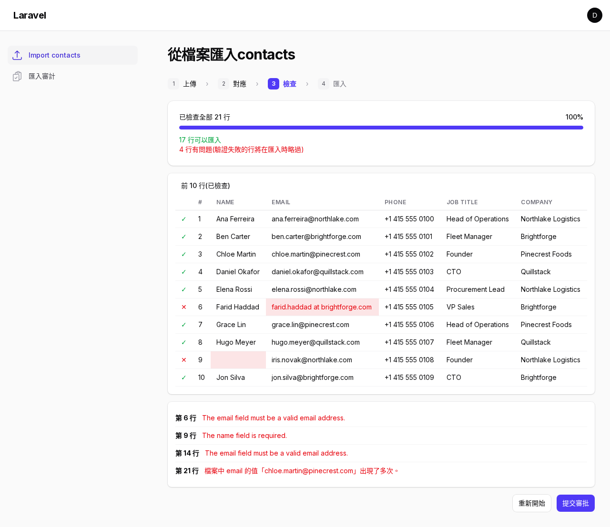

# Localization (i18n)

Every string the package shows lives in translation files — the wizard, the audit page, status labels, error messages
(including the ones the chunked uploader sends to the browser) and the validation rule messages. Numbers use the
app locale (`Number::format`), dates use `isoFormat('LLL')`, counts are pluralised (`1 row` / `2 rows`), and the layout uses
logical CSS properties so right-to-left locales work.

| Locale | |
| --- | --- |
| `en` | English (default / fallback) |
| `zh_CN` | 简体中文 |
| `zh_TW` | 繁體中文(台灣) |
| `zh_HK` | 繁體中文(香港) |



The package follows the app's locale (`app()->setLocale()` / `APP_LOCALE`), so it matches Filament's own language switching.
A test checks that every locale has exactly the keys and placeholders of `en`, and another that no hard-coded English slips into the views.

## Change a text or add a language

```bash
php artisan vendor:publish --tag=import-wizard-translations
```

This copies the files to `lang/vendor/filament-import-wizard/{locale}/` — edit a string there, or add a folder for a new locale
by copying `en/`. Groups: `import.php` (wizard), `audit.php` (audit page and statuses), `errors.php` (upload / file errors),
`rules.php` (rule messages). Contributions of new locales are welcome: copy `resources/lang/en`, translate, keep the `:placeholders`.

## What is still yours to translate

Some text belongs to your application, not the package:

| Text | How |
| --- | --- |
| Page title entity (`Import contacts from a file`) | Override `getEntityLabel()` on your page: `return __('contacts.plural');` |
| Navigation label of your import page | Override `getNavigationLabel()` as for any Filament page |
| Importer column labels | `ImportColumn::make('email')->label(__('contacts.email'))` |
| Laravel's validation messages (`The email field must be a valid email address.`) | Install the language files for your locale (e.g. `laravel-lang/lang`); the package's own rules (`PhoneNumber`, `DateInFormats`, `OneOfIgnoringCase`, `UniqueInFile`) are already translated |
| Filament's own notifications (import completed, failed-rows download) | Filament ships its translations |
| Console command output (`import-wizard:run`) | Developer-facing, English only |
