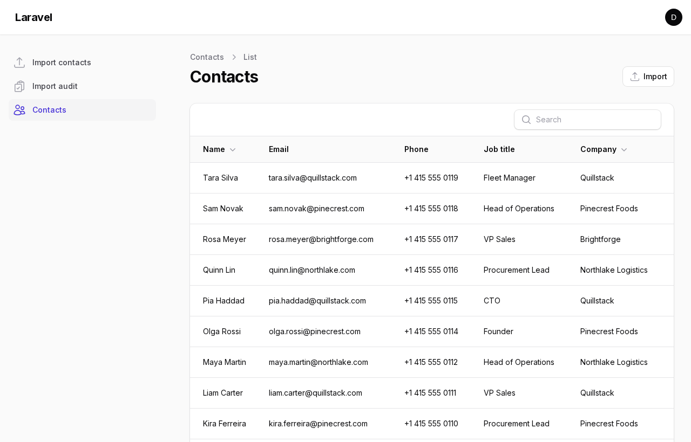
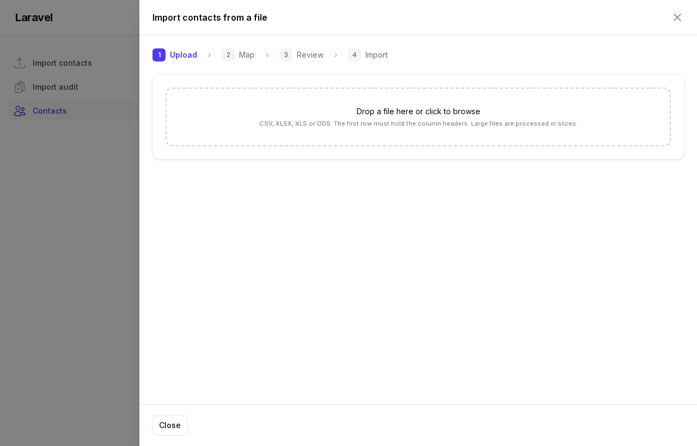
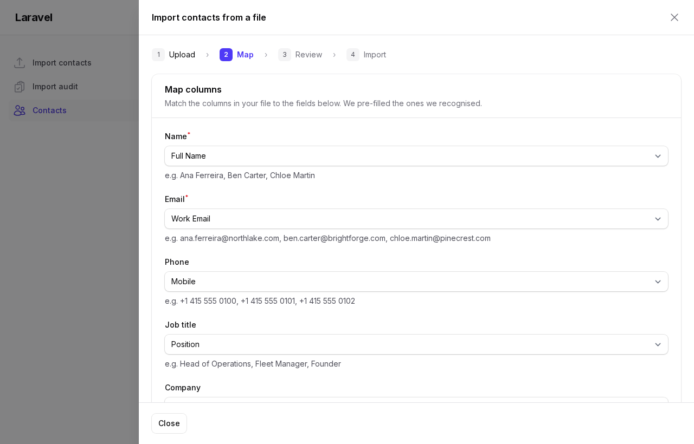
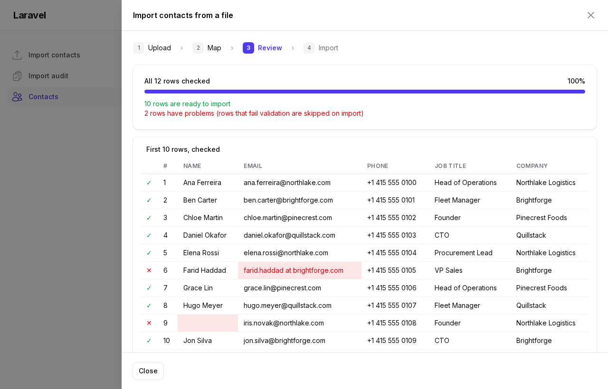
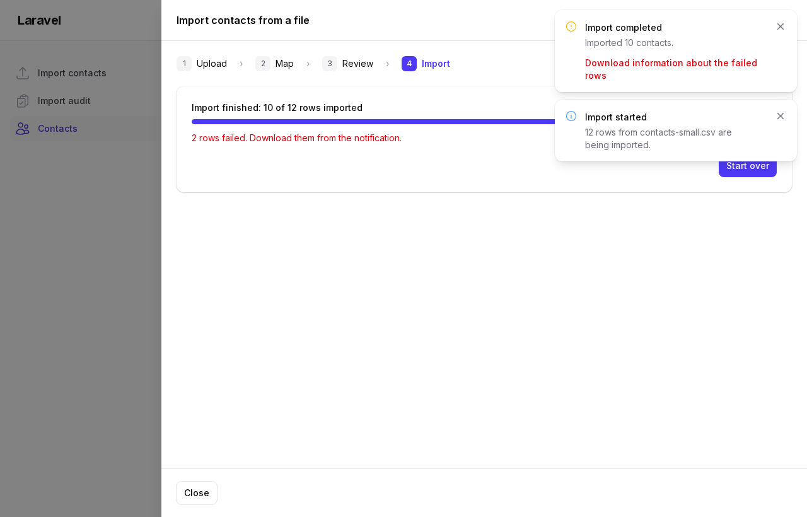
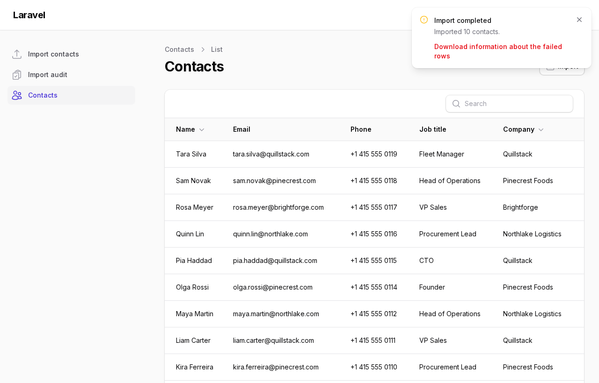

# Slide-over import action

The wizard is also available as a **Filament action** that opens it in a slide-over — from a resource list page, a table header, a widget or any page —
the way Filament's own import action does, but with the Upload → Map → Review → Import flow, live preview and pre-import validation.

| 1 · A button on the list page | 2 · Upload |
| --- | --- |
|  |  |
| **3 · Map, with live preview** | **4 · Review, with the row table** |
|  |  |
| **5 · Done — Filament notifications** | **6 · The table, up to date** |
|  |  |

## Add it

```php
use SolutionForest\FilamentImportWizard\Actions\ImportWizardAction;

class ListContacts extends ListRecords
{
    protected static string $resource = ContactResource::class;

    protected function getHeaderActions(): array
    {
        return [
            ImportWizardAction::make()->importer(ContactImporter::class),
        ];
    }
}
```

It also works in `$table->headerActions([...])`, `->toolbarActions()` or a widget. It is a normal Filament `Action`, so everything you know applies:
`->label()`, `->icon()`, `->color()`, `->visible()`, `->authorize()`, `->modalHeading()`, `->modalWidth()`. Defaults: slide-over, 5xl wide,
"Close" instead of a submit button, and clicking outside does not close it mid-import.

The panel's plugin settings (disk, directory, chunked uploads, audit / approval, fast validation, parallel review, …) apply exactly as for the full page, and the
page and the slide-over can be used side by side on the same importer.

## Notifications (optional)

Filament notifications mark the import as it runs; the slide-over itself shows the live progress in between.

| When | Notification |
| --- | --- |
| **Start** | *Import started* — "12 rows from contacts.csv are being imported." |
| **Process** | The slide-over shows the live progress bar and counts (polled). |
| **Done** | *Import finished* — "10 of 12 rows imported.", success or warning, with a **Download failed rows** button (the same signed link Filament uses). It is a toast the user still gets after closing the slide-over. |

On the `sync` queue the import finishes inside the request and **Filament sends its own persistent completion notification**, so the wizard skips its own
"finished" toast to avoid a duplicate. On a real queue Filament also writes its database notification (the bell) when the last job completes.

Choose what you want, per panel or per action:

```php
ImportWizardPlugin::make()->notifications(onStart: true, onFinish: true);   // panel default (both on)
ImportWizardAction::make()->importer(...)->notifications(onStart: false);   // this button only
```

The same notifications apply to the full-page wizard.

## Refresh the table when it is done

When an import finishes the wizard dispatches the Livewire event `import-wizard-finished` (with `importId`). A list page re-renders on it:

```php
use Livewire\Attributes\On;

#[On('import-wizard-finished')]
public function refreshAfterImport(): void {}
```

(The demo's contacts table also polls every 5 s.)

## How it works

The wizard logic lives in one concern, `Concerns\ManagesImportWizard`, used by both the full page (`ImportWizardPage`) and the slide-over's Livewire component
(`Livewire\ImportWizardModal`), so the two cannot drift apart. The action renders that component in its modal; the importer class is passed as a locked
property and must be a Filament `Importer`.

Try it: `composer serve`, open **Contacts**, press **Import**, and upload `workbench/samples/contacts-small.csv`.
